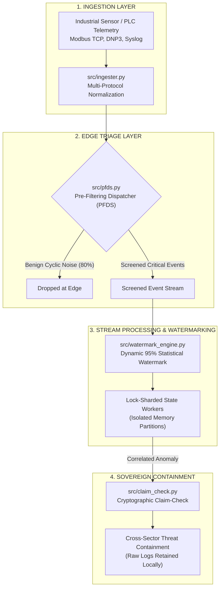

# federated-stream-defense-blueprint

# Unified National Detection Blueprint (UNDB) – Reference Implementation

**Author:** Namit Mohale  
**Associated Research:** Companion reference implementation for *"Federated Stream-Processing and Latency-Gated Response for Cross-Sector Threat Detection and Collaborative Containment"* (arXiv:2605.17325 / *IEEE Access* Submittal Track).  
**License:** Apache License 2.0 (Open-Source / Unrestricted Public Sector Adoption)

---

## 1. System Overview

This repository provides an open-source, vendor-neutral reference architecture for deploying real-time stream-processing threat detection across resource-constrained Operational Technology (OT) and Industrial Control System (ICS) environments. 

Specifically engineered for multi-jurisdictional critical infrastructure operators (such as municipal water authorities, regional electric cooperatives, and local healthcare districts), this framework eliminates reliance on proprietary, cost-prohibitive enterprise SIEM/XDR software.



## 2. Core Architectural Primitives

1. **Pre-Filtering Dispatcher Subsystem (PFDS):** Operates at the network edge to inspect high-throughput industrial event streams, performing stateless screening to shed up to 80% of benign telemetry noise before stateful queue allocation.
2. **Lock-Sharded Stateful Stream Workers:** Eliminates global locking contention by partitioning incoming security events by dynamic asset and register keys across isolated execution workers.
3. **95% Statistical Watermarking for Late-Arriving Telemetry:** Dynamically calculates an adaptive time watermark based on observed packet arrival delays. During network partitioning or telemetry latency spikes, the system holds processing windows open until 95% of out-of-order logs converge, eliminating false negatives without causing queue stalls.
4. **Cryptographic Claim-Check Sovereignty Pattern:** Decouples detection containment signals from sensitive raw operational logs. When anomalous behavior is flagged across federated entities, only cryptographically signed threat indicators are transmitted cross-sector, preserving local data privacy and regulatory sovereignty.

## 3. Federal Policy Alignment

* **President Trump’s Cyber Strategy for America (March 2026):** Pillars 3, 4, and 5 mandate edge-localized, machine-speed automated detection to confront adversaries before network compromise.
* **CISA Joint Guide on Adapting Zero Trust to Operational Technology (April 2026):** Implements mitigation for wide-area network partitioning vulnerabilities in municipal utility infrastructures.

## 4. Quickstart & Verification

```bash
# Clone the repository
git clone [https://github.com/](https://github.com/)[YourGitHubUsername]/federated-stream-defense-blueprint.git
cd federated-stream-defense-blueprint

# Run the complete end-to-end detection simulation
python run_simulation.py
```
---
